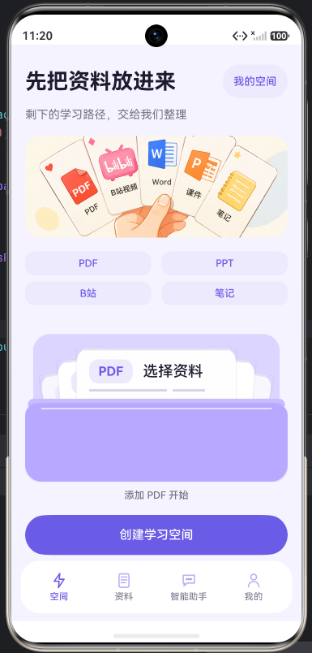
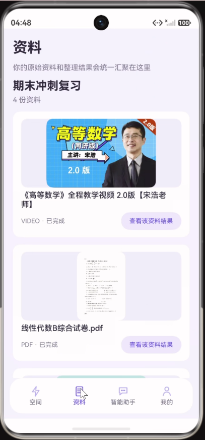
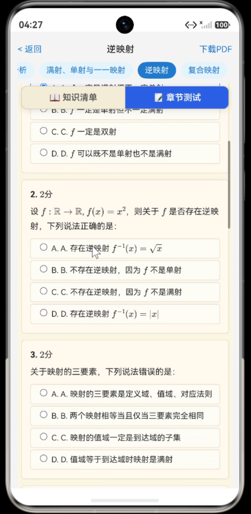
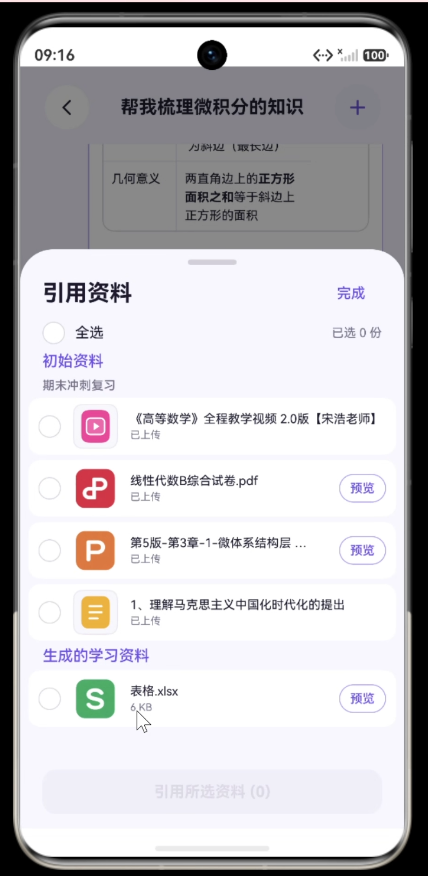
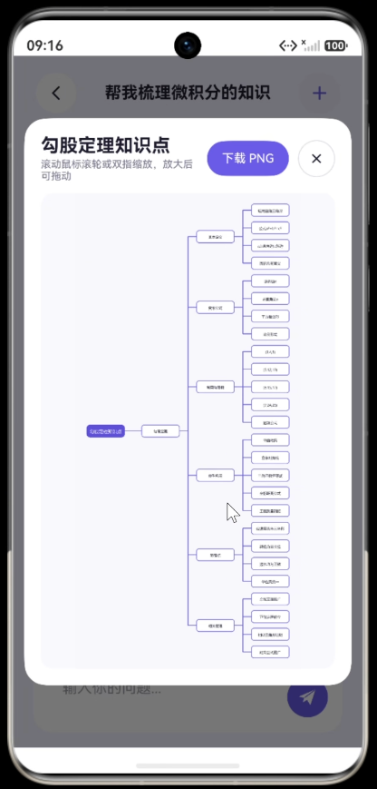
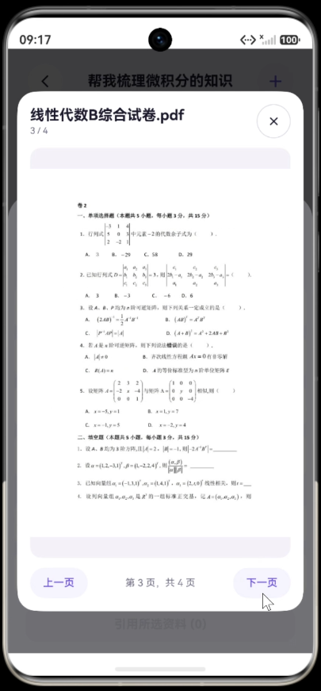
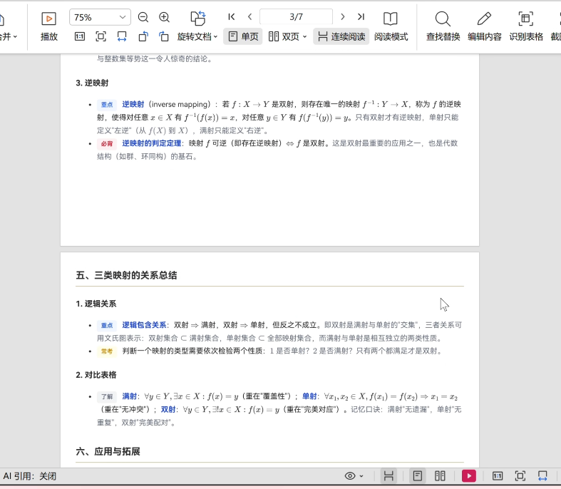
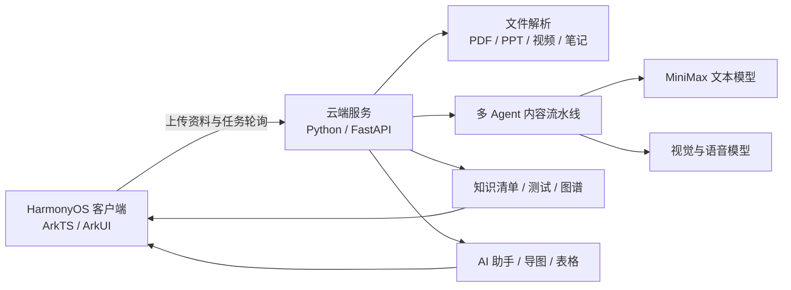

# EasySorting

基于 HarmonyOS 的 AI 课程学习空间，将分散的 PDF、PPT、课程视频和文字笔记整理为可阅读、可追问、可练习的学习路径。

> 本仓库用于展示项目设计、产品效果与演示材料，不包含项目源码。

<p align="center">
  <a href="https://github.com/sweet11021101-png/EasySorting/releases/download/v1.0-demo/default.mp4"><strong>▶ 播放完整项目演示视频</strong></a>
  &nbsp;·&nbsp;
  <a href="docs/EasySorting.pptx">下载项目介绍 PPT</a>
</p>

<p align="center"><sub>视频文件约 258 MB，托管于 GitHub Releases。</sub></p>

<p align="center">
  
</p>

## 项目背景

大学生的课程资料经常分散在课件、文档、视频和个人笔记中。复习时需要反复整理、查找重点和核对原文，真正用于理解与练习的时间被大量压缩。

EasySorting 以“学习空间”为核心，把资料整理、章节学习、引用问答、测试反馈和个性化复习接入同一条流程。系统采用“学习空间 + AI 助手”的双引擎设计：学习空间负责结构化学习，AI 助手负责灵活问答与内容生成。

## 核心功能

- **多源资料导入**：支持 PDF、PPT、课程视频和文字笔记。
- **知识清单生成**：将原始资料重构为分章节内容，并标注重点、易错点和公式。
- **章节测试**：生成单选、多选、判断、填空、简答、计算、代码、问答和综合题等 9 类题型。
- **引用式问答**：AI 回答可关联学习空间中的资料，方便返回原文核对。
- **思维导图与表格导出**：在对话中识别生成意图，输出 PNG 思维导图或 Excel 表格。
- **对话分支与收藏**：从任意历史消息创建分支，保留不同解题路径与重点内容。
- **学习画像**：记录学习与答题表现，用于调整后续练习的题型、难度和薄弱知识点覆盖。
- **考前冲刺**：对多份资料去重和压缩，形成更集中的复习内容。

## 产品效果

<table width="100%">
  <tr>
    <td align="center" width="33%">
      <br>
      <sub><strong>多源资料导入</strong></sub>
    </td>
    <td align="center" width="33%">
      <br>
      <sub><strong>资料统一管理</strong></sub>
    </td>
    <td align="center" width="33%">
      <br>
      <sub><strong>章节测试</strong></sub>
    </td>
  </tr>
  <tr>
    <td align="center" width="33%">
      <br>
      <sub><strong>资料引用</strong></sub>
    </td>
    <td align="center" width="33%">
      <br>
      <sub><strong>对话分支</strong></sub>
    </td>
    <td align="center" width="33%">
      <br>
      <sub><strong>思维导图生成</strong></sub>
    </td>
  </tr>
  <tr>
    <td align="center" width="33%">
      <br>
      <sub><strong>图片文字追问</strong></sub>
    </td>
    <td align="center" width="33%">
      <br>
      <sub><strong>试卷预览</strong></sub>
    </td>
    <td align="center" width="33%">
      <br>
      <sub><strong>测试内容导出</strong></sub>
    </td>
  </tr>
</table>

## 系统架构



### 七阶段内容流水线

1. 提取原始资料中的文字、表格和图片。
2. 通读资料并生成课程知识骨架。
3. 按章节并行生成知识清单与测试题。
4. 检查内容完整性与正确性。
5. 通过做题验证答案和解析。
6. 汇总反馈并定向修订问题章节。
7. 渲染可交互的 HTML 学习内容。

系统将 Agent 协作固化为显式状态机，并通过异步并发、状态记录和失败重试提升长任务的可观察性与恢复能力。

## 技术栈

| 层级 | 技术 | 用途 |
| --- | --- | --- |
| HarmonyOS 客户端 | ArkTS、ArkUI、Web 组件 | 原生交互、学习空间管理、HTML 学习内容呈现 |
| 云端服务 | Python、FastAPI、asyncio | REST API、长任务编排、并发处理 |
| 文件解析 | python-pptx、pdfplumber、PyMuPDF | 提取课件文字、表格和图片 |
| 大模型能力 | MiniMax M3、VL-01、speech-01、image-01 | 内容生成、视觉理解、语音识别和封面生成 |
| 可视化与导出 | D3.js、Pillow、openpyxl | 知识图谱、思维导图和 Excel 导出 |
| 测试 | pytest、Hypium | 后端单元测试与 HarmonyOS 端自动化测试 |

## 工程实践

- 使用确定性阶段函数编排 AI 流程，避免完全依赖模型自行决定执行顺序。
- 对模型结构化输出进行校验和重试，降低 JSON 格式异常对流程的影响。
- 对课程视频采用字幕、ASR 和多模态理解的递进式提取策略。
- 将长任务异步化，客户端通过任务 ID 查询处理状态与章节进度。
- 通过资料引用、源文件预览和本地缓存，帮助用户核对 AI 生成内容。
- 围绕资料导入、内容生成、用户画像、AI 助手和资料管理建立分层测试。

在 50 次端到端管线测试中，系统记录到 86.7% 的总体成功率。主要失败来源是模型输出格式异常与部分章节生成超时，这些结果也明确了后续需要继续优化的方向。

## 仓库内容

```text
EasySorting/
├── README.md
├── assets/
│   └── screenshots/    # 产品效果图
└── docs/
    └── EasySorting.pptx # 项目介绍演示文稿
```

完整操作视频存放在仓库的 [Releases](https://github.com/sweet11021101-png/EasySorting/releases) 页面，也可以通过 README 顶部的入口直接播放或下载。

## 当前限制

- AI 内容质量仍受输入资料质量和模型输出稳定性影响。
- 长资料和长对话会增加处理时间，需要继续优化上下文压缩与失败恢复。
- AI 推理依赖云端服务，完整生成流程需要网络连接。
- 本仓库仅用于项目成果展示，暂不提供可运行源码、部署脚本或在线体验地址。
